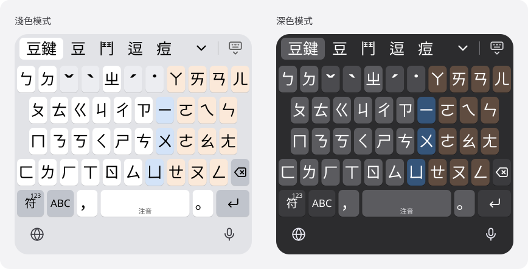
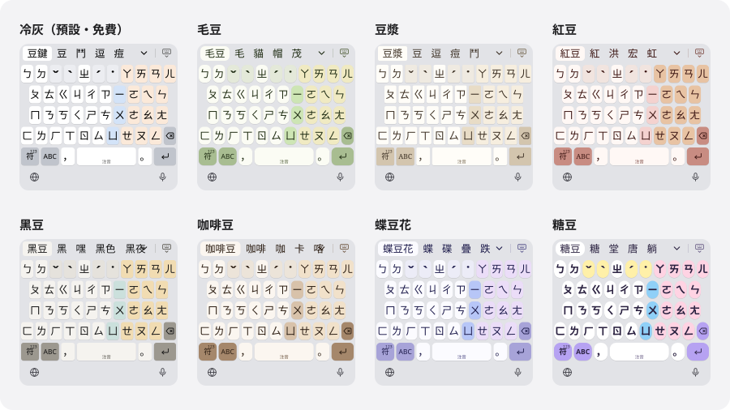
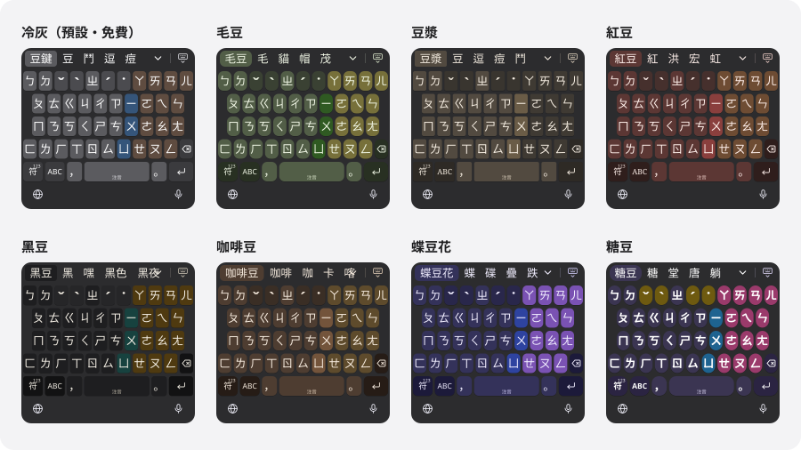
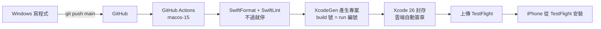

# 豆鍵 bigkeyboard

字大、鍵距緊的 iOS 注音鍵盤。我從別的手機換到 iPhone 之後，打注音一直按到旁邊的鍵，ㄢ 變 ㄦ、ㄣ 變 ㄤ，一句話要刪好幾次，所以自己做了一個。名字是一排豆子，一顆豆一個鍵。



> 本頁的圖是用程式裡的色碼畫的示意圖，鍵位、顏色跟實機一樣，字體依你的電腦顯示。改了主題色碼後重畫：`python docs/make_images.py .`

目前狀態：TestFlight 測試中，準備上架 App Store。上架步驟見 [`.vibe/上架指南.md`](.vibe/上架指南.md)。

---

## 功能

### 鍵盤

- 標準注音排法，41 個符號壓在四排鍵上。第二、三排左右錯開半顆，鍵跟第一排一樣寬
- 鍵帽字比原生鍵盤大；聲調 ˇ ˋ ˊ ˙ 另外放大加粗，不會細到只剩一個點
- 注音分區上色：介音 ㄧㄨㄩ 剛好排成中間一直欄，塗淡藍，韻母塗淡橘，聲調淡灰。聲母在左、韻母在右，一眼分得出來
- 按下去跳出放大泡泡，看得到按了哪顆
- 打了聲母之後，介音和韻母的感應範圍往外多 10pt；打了介音之後只剩韻母放大。鍵的外觀不變，iPhone 原生鍵盤也是這樣做
- 按在鍵縫、錯開的半顆空位，算離得最近的那顆；快打時上一顆還沒放開、下一顆已經按下，照按下的順序送字
- 英文鍵盤（QWERTY＋常駐數字列）、符號兩頁、4×4 數字鍵盤（長按「符」進入）。中文模式的標點是全形，英文模式是半形
- 收鍵盤：注音鍵面按工具列最右邊的收鍵盤鍵；其他鍵面長按換行鍵
- 深色模式跟著系統，也跟著輸入框的要求

### 選字

- 注音引擎和詞庫用開源的[小麥注音](https://github.com/openvanilla/McBopomofo)（MIT 授權），全部在手機上跑
- 聲調可以不打，豆鍵會自己找；打到一半換下一個音也會自己斷開
- 改選過的詞會記下來，下次排前面
- 看游標前面一兩個字，把自己平常接在後面打的詞排到前面
- 候選太多就按 ⌄ 展開，一次看完

### 豆鍵 App

App 底部有三個分頁：

- 字典：鍵盤自動學到的詞、自己手動加的詞，可以篩選、搜尋、左滑刪除。手動加詞時注音從詞庫自動帶出
- 主題：8 款主題，冷灰免費，另外 7 款各 NT$60（App 內購買，買一次永久有，有「回復購買」）
- 使用說明：怎麼加入鍵盤、為什麼要開完全取用、怎麼收鍵盤

---

## 主題

主題換的是鍵帽顏色、字體和圓角，鍵位和手感都不動。每款都有淺色、深色兩套，三個注音分區用深淺分得開。





| 主題 | 價格 | 長相 |
|---|---|---|
| 冷灰 | 免費（預設） | 跟系統鍵盤底色搭的冷灰 |
| 毛豆 | NT$60 | 嫩綠豆莢配淡黃豆仁，圓角大一點 |
| 豆漿 | NT$60 | 米白底，明體鍵帽字（Noto Serif TC） |
| 紅豆 | NT$60 | 紅豆沙和粉色，楷書鍵帽字（霞鶩文楷 TC） |
| 黑豆 | NT$60 | 深色模式最好看：黑鍵、琥珀色韻母 |
| 咖啡豆 | NT$60 | 拿鐵到深焙的咖啡色階 |
| 蝶豆花 | NT$60 | 介音藍、韻母淡紫 |
| 糖豆 | NT$60 | 糖果色、大圓角、粗體字 |

主題色碼、圓角、字體都在 [`Shared/KeyboardTheme.swift`](Shared/KeyboardTheme.swift)。內購的產品 ID 是 `org.domyweb.bigkeyboard.theme.<主題英文名小寫>`，例如 `org.domyweb.bigkeyboard.theme.edamame`。

---

## 安裝與使用

1. 從 TestFlight（上架後從 App Store）安裝豆鍵
2. 到「設定 → 一般 → 鍵盤 → 鍵盤 → 新增鍵盤」，選豆鍵
3. 在鍵盤設定裡打開「允許完全取用」（不開也能打字，只是不會學詞、主題固定冷灰）
4. 打字時按地球鍵切換到豆鍵；要打表情符號，按住地球鍵切回系統鍵盤

豆鍵沒有表情符號頁、語音輸入、英文自動更正，這些都沒打算做。

---

## 隱私

豆鍵沒有任何連網程式，沒有廣告、分析工具或第三方追蹤。

「允許完全取用」只是因為 iOS 規定鍵盤要寫進和 App 共用的資料夾（App Group `group.org.domyweb.bigkeyboard`）就得開。共用的只有三樣，全部留在手機上：

- 字典（`dictionary.json`）：自動學到的詞、手動加的詞
- 接字紀錄：游標前一兩個字，和接著用豆鍵打出的一到四個字與次數，不記整段文字
- 目前選的主題

付費主題走 Apple 的 App 內購買，付款資料我拿不到。完整的隱私權政策在 [`.vibe/上架文案.md`](.vibe/上架文案.md)。

---

## 開發

### 我沒有 Mac，所以這樣編

在 Windows 上寫 Swift，推上 GitHub 之後全部交給 GitHub Actions 的 macOS 機器：



- 每推一次 main 就編一版，build 號等於這次 workflow 的 run 編號
- 只改文件的 commit 訊息加 `[skip ci]`，不白燒 macOS 分鐘數。注意：一次 push 裡最後一個 commit 帶 `[skip ci]`，整次 push 都不會編
- GitHub 偶爾排不到 macOS 機器（`The job was not acquired by Runner`），跟程式無關，重跑就好：

```bash
gh run rerun <run id> --repo domyweb666/bigkeyboard
```

### 技術

| 部分 | 用什麼 |
|---|---|
| 鍵盤擴充 | Swift＋UIKit（`UIInputViewController`），鍵帽用 `UIControl`＋`UILabel`，不用 `UIButton` |
| 注音引擎 | 小麥注音的 C++ 組字器與詞庫，透過 Objective-C++ 橋接（`BopomofoEngine.mm`） |
| 豆鍵 App | SwiftUI |
| 內購 | StoreKit 2，非消耗性商品 |
| 專案檔 | XcodeGen（`project.yml`），repo 裡不放 `.xcodeproj` |
| 最低版本 | iOS 17，用 Xcode 26（iOS 26 SDK）編 |
| 套件識別碼 | App `org.domyweb.bigkeyboard`，鍵盤 `org.domyweb.bigkeyboard.keyboard` |

鍵盤只靠兩個介面跟引擎溝通：送注音進去、拿候選字出來。畫面層不碰引擎內部，引擎不碰 UIKit。

### 專案結構

```
App/                         豆鍵 App（SwiftUI）
  ContentView.swift            三個分頁：字典、主題、使用說明
  DictionaryView.swift         字典頁；AddWordView.swift 加詞
  ThemeView.swift              主題頁：選主題、購買、回復購買
  ThemePurchases.swift         StoreKit 2：拿商品、買、對帳、回復購買
  GuideView.swift              使用說明
KeyboardExtension/           鍵盤擴充
  KeyboardViewController*.swift  鍵盤殼：模式切換、組字、學詞、收鍵盤、跟著輸入框的深淺色
  Layout/KeyboardLayout.swift    四張鍵面的鍵位表（資料，不是程式邏輯）
  Layout/SamsungTheme.swift      尺寸常數；顏色、字體、圓角照目前主題
  Views/                         鍵帽、鍵盤、候選列、展開格子、預覽泡泡
  Engine/Bridge/                 小麥注音的橋接層
  Engine/Vendor/McBopomofo/      小麥注音原始碼（原樣搬入）
  Resources/                     詞庫、主題字體
Shared/                      App 和鍵盤共用
  KeyboardTheme.swift            8 款主題的色碼、字體、圓角、內購 ID
  UserDictionary.swift           字典檔讀寫（App Group）
docs/                        README 的圖（images/）和畫圖的程式（make_images.py）
.github/workflows/           TestFlight 編譯上傳、格式修正建議、ASC 狀態查詢
.vibe/                       產品定稿、架構藍圖、切片帳本、測試清單、規矩檔
project.yml                  XcodeGen 設定
```

### 格式檢查

CI 在編譯前跑 SwiftFormat（lint 模式）和 SwiftLint（`--strict`，警告也算失敗），規則在 `.swiftformat`、`.swiftlint.yml`。Windows 上跑不了這兩個工具，常踩的地雷：

- 一行最多 120 欄，中文字算 2 欄
- 單行 `if` 的主體要換行
- 宣告上面緊貼的 `//` 註解會被要求改成 `///`；只是分組用的註解，跟宣告之間空一行
- 計算屬性、函式前後要空一行
- 函式的 cyclomatic complexity 超過 10 會被擋，拆成小函式

格式不確定時，到 Actions 手動跑「格式修正建議」，它會產出 patch。

### GitHub Secrets

TestFlight workflow 需要這四個（App Store Connect 的 Team Key，Admin 權限，要勾「Access to Cloud Managed Distribution Certificate」）：

| 名稱 | 內容 |
|---|---|
| `ASC_KEY_ID` | API 金鑰 ID |
| `ASC_ISSUER_ID` | Issuer ID |
| `ASC_PRIVATE_KEY` | `.p8` 金鑰全文 |
| `APPLE_TEAM_ID` | 開發者 Team ID |

本機的 pre-commit hook（`.githooks/pre-commit`）會擋住 `.p8`、`.p12`、`.mobileprovision` 和檔名含 secret、key 的檔案進 repo。

### 讓 AI 接手前

專案用 VibeRails 流程跟 Claude Code 協作，紀錄都在 `.vibe/`。動工前先讀 [`.vibe/規矩檔.md`](.vibe/規矩檔.md)，裡面有踩過的坑（簽章、build 號、iOS 26 鍵盤限制）。

| 檔案 | 內容 |
|---|---|
| `.vibe/產品定稿.md` | 做什麼、不做什麼 |
| `.vibe/架構藍圖.md` | 流程結構 |
| `.vibe/切片帳本.md` | 每一片的進度 |
| `.vibe/總測試清單.md` | 每個 build 要在實機測的項目 |
| `.vibe/上架指南.md` | 付費合約、內購項目、送審步驟 |
| `.vibe/上架文案.md` | App Store 文案、隱私權政策、支援頁 |

---

## 第三方授權

| 項目 | 授權 | 用在哪 |
|---|---|---|
| [小麥注音 McBopomofo](https://github.com/openvanilla/McBopomofo) | MIT | 注音引擎與詞庫 |
| [Noto Serif TC](https://github.com/notofonts/noto-cjk) | SIL Open Font License 1.1 | 豆漿主題的鍵帽字 |
| [霞鶩文楷 TC](https://github.com/lxgw/LxgwWenkaiTC) | SIL Open Font License 1.1 | 紅豆主題的鍵帽字 |

詳細來源、版本和授權全文的位置見 [`THIRD_PARTY_LICENSES.md`](THIRD_PARTY_LICENSES.md)。

豆鍵本身的程式碼授權：（需作者補充）
